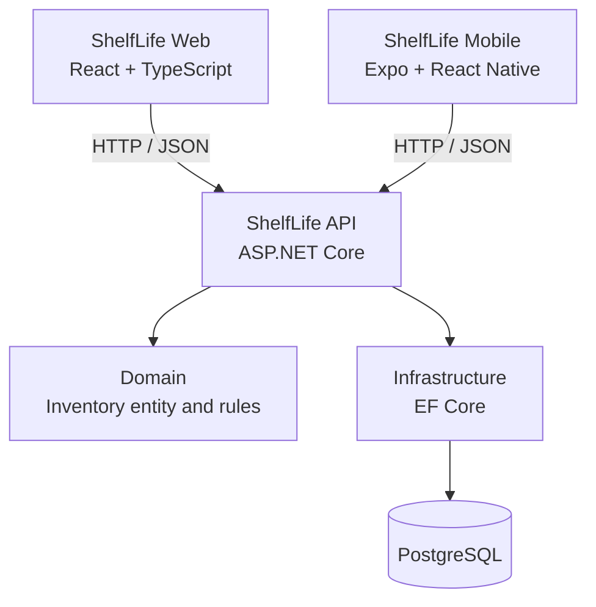

# ShelfLife API

<div align="center">

**One backend for the ShelfLife web and mobile applications.**

The ASP.NET Core API manages food inventory records and persists them in PostgreSQL. Both clients use the same REST endpoints, so changes made from one client are available to the other.


</div>

ShelfLife is a food inventory project built to help people keep track of groceries and use them before they expire.

This repository is the backend foundation. It owns the inventory API, domain rules and database persistence. The web and mobile repositories are clients; they do not maintain separate inventory stores.

## How it fits together



The API uses Entity Framework Core with the Npgsql provider to communicate with PostgreSQL. Expiry dates are represented as calendar dates and stored using PostgreSQL's `date` type, rather than being stored as timestamps.

## What is implemented

### Inventory endpoints

The current API supports:

- Creating an inventory item.
- Retrieving all items, ordered by expiry date.
- Filtering inventory by storage category.
- Retrieving one item by its ID.
- Updating an existing item.
- Deleting an item.
- Retrieving items expiring within a selected number of days.

### Domain rules

The inventory entity contains the item's name, quantity, measurement unit, expiry date and storage category. Creation and update operations use domain methods to validate the item data.

Supported measurement units:

`Count` · `Gram` · `Kilogram` · `Milliliter` · `Liter`

Supported storage categories:

`Fridge` · `Pantry` · `Freezer`

### Database persistence

Entity Framework Core maps the inventory entity to PostgreSQL. The repository includes an initial migration and model snapshot so the database schema can be created and tracked through migrations.

## API reference

Base route: `/api/inventory`

| Method | Endpoint | Purpose |
|---|---|---|
| GET | `/api/inventory` | List inventory |
| GET | `/api/inventory?category=Fridge` | Filter by storage category |
| GET | `/api/inventory/{id}` | Retrieve one item |
| POST | `/api/inventory` | Create an item |
| PUT | `/api/inventory/{id}` | Update an item |
| DELETE | `/api/inventory/{id}` | Delete an item |
| GET | `/api/inventory/expiring?withinDays=3` | Find items expiring within a date window |

The `withinDays` query value must be between 0 and 365.

### Example request

```json
{
  "name": "Milk",
  "quantity": 2,
  "unit": "Liter",
  "expiryDate": "2026-12-01",
  "category": "Fridge"
}
```

Enum values are sent as strings. The API returns date-only values in `YYYY-MM-DD` format.

The API also exposes:

- `GET /health` — a basic health response.
- `GET /openapi/v1.json` — OpenAPI document in the Development environment.

## Technology

| Area | Technology |
|---|---|
| API | C#, ASP.NET Core Web API |
| Runtime | .NET 10 |
| Domain | C# domain model and validation |
| Persistence | Entity Framework Core 10 |
| Database provider | Npgsql |
| Database | PostgreSQL 17 |
| Local database | Docker Compose |
| Tests | xUnit, ASP.NET Core integration testing |
| CI | GitHub Actions |

## Run locally

### Requirements

- .NET 10 SDK
- Docker Desktop with Docker Compose
- EF Core command-line tools for applying migrations

### 1. Clone the repository

```bash
git clone https://github.com/ZinhleHlongwane/ShelfLife-API.git
cd ShelfLife-API
```

### 2. Start PostgreSQL

```bash
docker compose up -d postgres
```

The Compose file creates a local development database on port `5432`. Its credentials are for local development only; do not reuse them in a deployed environment.

### 3. Restore and build

```bash
dotnet restore ShelfLife.sln
dotnet build ShelfLife.sln
```

### 4. Apply the database migration

If the EF Core CLI tool is not installed:

```bash
dotnet tool install --global dotnet-ef --version 10.*
```

Then apply the committed migration:

```bash
dotnet ef database update --project src/ShelfLife.Infrastructure --startup-project src/ShelfLife.API
```

### 5. Run the API

```bash
dotnet run --project src/ShelfLife.API
```

Use the local URL printed by ASP.NET Core. The default development connection string targets the PostgreSQL container on `localhost:5432`.

To override the connection string, use the standard ASP.NET Core configuration key `ConnectionStrings__ShelfLife` as an environment variable. Do not commit real credentials.

## Tests and continuous integration

Run the solution tests:

```bash
dotnet test ShelfLife.sln
```

The API integration test uses a PostgreSQL database through the `SHELFLIFE_TEST_CONNECTION` environment variable. It exercises the inventory flow, including create, read, category filtering, expiry filtering, update, validation and delete behaviour.

GitHub Actions provisions PostgreSQL 17, restores and builds the solution, and runs the tests on pushes and pull requests to `main`.

## Repository structure

```text
src/
├── ShelfLife.API/
│   ├── Contracts/       # Inventory request and response contracts
│   └── Controllers/     # HTTP endpoints
├── ShelfLife.Domain/
│   ├── Entities/        # Inventory domain entity
│   └── Enums/           # Units and storage categories
└── ShelfLife.Infrastructure/
    └── Persistence/    # DbContext, EF configuration and migrations

tests/
├── ShelfLife.API.Tests/
└── ShelfLife.Domain.Tests/
```

## Security status and current limitations

Authentication and household ownership are not implemented yet. At the moment, the inventory endpoints do not require a signed-in user and inventory records are not isolated by household.

That means this API is a development foundation, not a public or production-ready service. Do not expose it to the public internet or store real household data in it until authentication, authorisation, household-level data isolation, production secrets management and the related tests are implemented.

The intended direction is documented in [ADR-001: Authentication and Households](docs/architecture/ADR-001-authentication-and-households.md). The decision record describes the planned approach; it does not mean those features have already been built.

## What's next

- [x] Establish the ASP.NET Core API and domain model.
- [x] Add PostgreSQL persistence with Entity Framework Core.
- [x] Add the initial database migration.
- [x] Implement inventory CRUD and expiry filtering.
- [x] Add PostgreSQL-backed API integration coverage.
- [x] Connect the web and mobile clients to the shared inventory API.
- [ ] Implement authentication and household membership.
- [ ] Scope every inventory operation to the authenticated household.
- [ ] Add cross-household authorisation tests.
- [ ] Add production configuration and deployment safeguards.

---

Built by [Zinhle Hlongwane](https://github.com/ZinhleHlongwane) · Johannesburg, South Africa 🇿🇦
